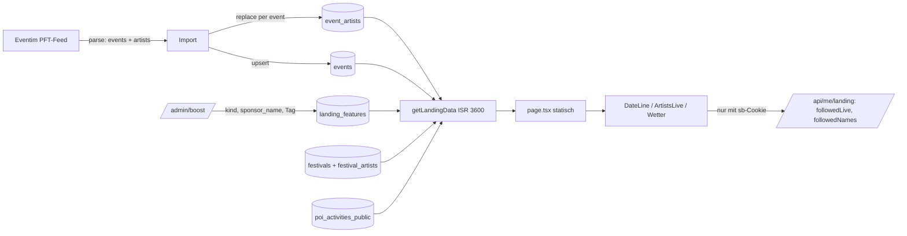

# Startseite als Tagesausgabe

## Overview
Die Startseite (`src/app/[locale]/page.tsx`) wirkt wie ein Template (zehn gleiche Sektionen,
24 Eyebrows, 25 Kästen, Künstler-Pitch viermal, Konzerte = Wochenend-Dubletten, Festivals ohne
Line-up, Karte mit erfundener Legende; Befund `docs/design/landing-redesign/ANALYSE.md`). Sie
wird zur Tagesausgabe nach Mockup D (`docs/design/landing-redesign/d-tagesausgabe.html`, vom
User am 29.10.2026 bestätigt): Kopf mit Datum, Wetter und Event-Zahl, eine Bühne aus vier
ungleichen Karten mit je einer Rolle, darunter wechselnde Formen statt gestapelter Regale.

Die Seite bleibt eine statische ISR-Shell (`revalidate = 3600`, `setRequestLocale` vor jeder
Übersetzung, Anon-Client in `src/lib/v4/get-landing-data.ts`, kein `cookies()`; MASTERPLAN
§10.2). Personalisierung läuft client-seitig über `/api/me/landing`. Designsprache =
`/entdecken` (PR #328): `Shelf`, `ShelfCard`, `RegionTile` aus
`src/components/Discover/v4/shelf-ui.tsx` wiederverwenden, keine neue Kartenform für Events.

## Scope

### Kopf
Datumszeile: Wochentag und Datum (Europe/Vienna), Wetter **heute in Wien** (Client-Insel,
Variante von `loadWeekendWeather` in `src/lib/landing/weekend-weather.ts`, die den heutigen Tag
liefert; Platz ist reserviert, damit nichts springt), Event-Zahl. H1 „Bleib ned daham.“,
`V4SearchInput variant="hero"` (`src/components/Layout/v4/V4SearchInput.tsx`). Kein
Entwicklungs-Banner oben; der Hinweis wird eine Zeile im Footer (Footer ist auf drei Seiten
geteilt, deshalb per Prop) und verliert den Gedankenstrich.

**Event-Zahl:** `event_counts_for_stats()` zählt heute eine Bounding-Box (inkl. Südtirol und
Bayern). Die MV `event_stats_cache` bekommt ein Feld `country_total` (published, `start_date >=
now()`, `country = 'AT'`), die RPC liefert es mit; die Zeile zeigt es gerundet („über 88.000“).

### Bühne (Desktop `1.45fr 1fr 1fr`, zwei Zeilen à 256 px; Handy einspaltig)
1. **Tipp des Tages** (links, zwei Zeilen hoch): genau ein Event.
   - Quelle `landing_features` mit `kind = 'sponsored'`, deren Fenster den heutigen Wiener Tag
     deckt; genau eine Buchung je Kalendertag (Admin-API weist Überschneidungen mit 409 ab).
     Pins mit `kind = 'editorial'` speisen wie bisher die Saison-Karte, nicht den Tipp.
   - Ohne Buchung: redaktionelle Wahl, das bestgescorte Event mit scharfem Bild
     (`arrangeBySharpness`) der nächsten 7 Tage; der Tipp wählt **zuerst**, danach Saison,
     Programm, Wochenende (feste Reihenfolge, keine Kreisregel).
   - Pflicht-Filter für gepinnte Events: `publish_status = 'published'`, `country =
     SITE_COUNTRY`, `coalesce(end_date, start_date) >= heute`; fällt das Event heraus, greift
     der Fallback und der Admin sieht es in `/admin/boost` als „abgelaufen“.
   - Kennzeichnung: bei `sponsored` das Wort **„Anzeige“** (EN „Advertisement“) sichtbar auf der
     Karte plus `sponsor_name` (§ 26 MedienG, § 6 ECG; „Gesponsert“ genügt nicht). Bei
     `editorial` und Fallback kein Label. Zweite Zeile: `sponsor_name`, sonst `location_name`,
     nie `source_name`.
   - Karte: Bild (`EventImage`, LCP, `preload`), Label „Tipp des Tages“, Titel, Datum/Ort,
     Knopf „Tickets ab …“ (`priceBadge`, sonst „Zum Event“) → Event-Detailseite (die TicketBox
     trägt den Affiliate-Link). `data-track="landing_tip_click"`, `data-track-id` = Event-ID,
     dazu `data-track-kind`.
2. **Saison**: `SeasonCard` + `SeasonWeather` bleiben, `pickSeasonEvents(count 6)`, Liste füllt
   die Karte (`space-evenly`), Titel mit Ellipsis (`min-width: 0`). Das „Tipp“-Badge der
   Saison-Karte zeigt nur noch `editorial`-Pins.
3. **Karte**: Mapbox-Static-Bild (`dark-v11`, `NEXT_PUBLIC_MAPBOX_TOKEN`, plain `` mit
   `srcset` 1x/2x, kein next/image) mit Pins der heutigen Events (`locationOutputs(event).pin`
   aus `src/lib/location/gating.ts`, Koordinaten auf 4 Stellen gerundet und sortiert, max. 40,
   URL < 8.192 Zeichen; ohne Pins fester Österreich-Ausschnitt). Logo bleibt an; direkt unter
   der Kachel die Zeile „© Mapbox © OpenStreetMap · Karte verbessern“ mit Links. Text „Heute auf
   der Karte“, Knopf „Karte öffnen“ → `/map`. Ohne Token oder bei Bildfehler: Kachel mit
   dunklem Verlauf und demselben Knopf. `data-track="landing_map_open"`.
4. **Diese Woche live**: drei Künstler (Bild rund 36 px, Name, nächster Termin mit Tag,
   Uhrzeit, Ort) mit Knopf „Folgen“ (`min-width: 88px`, `white-space: nowrap`, feste
   Grid-Spalte, gleiche Position in jeder Zeile). Ohne Pool entfällt die Kachel und die Karte
   wird zwei Zeilen hoch. Link „Alle Künstler“ → `/artists`.

### Künstler aus der Eventim-Quelle
Der PFT-Feed liefert je Serie `artists` (`EventimArtist` in `src/lib/eventim/types.ts`:
`artistId`, `artistName`, `artistImage?`, `evoLink?`); `parse.ts` liest sie bisher nicht.
- Tabelle `event_artists (event_id uuid references events(id) on delete cascade, artist_id
  text, artist_name text not null, artist_image text, evo_link text, source text not null
  default 'eventim', updated_at timestamptz default now(), primary key (event_id, artist_id))`,
  Index auf `artist_id`, Index auf `(artist_name)`; RLS `for select to anon, authenticated
  using (true)`, `grant all to service_role`; nach der Migration `NOTIFY pgrst, 'reload
  schema'` (Embedding braucht den FK im Schema-Cache).
- `parseEventimFeed` gibt die Serien-Künstler je Event als Nebenergebnis zurück (`ScrapedEvent`
  bleibt unverändert, `rawContentHash` unberührt). Leere Namen werden verworfen, Serien ohne
  `artists` liefern nichts. Alle Länder des Feeds (DE/CH für spätere .de/.ch-Seiten).
- `upsertEventimEvents` löst nach dem Event-Upsert die Event-IDs über `source_name = 'Eventim'`
  und `.in('source_id', chunk ≤ 200)` auf (Muster `src/lib/db/source-id-migration.ts:141`),
  entdoppelt je Chunk nach (event_id, artist_id), upsertet mit `onConflict:
  'event_id,artist_id'` in Batches ≤ 500 und **löscht je Event die Zeilen, die der Feed nicht
  mehr nennt** (Events werden nie gelöscht, der FK-Cascade greift praktisch nie). Dry-Run
  schreibt nichts. Schlägt der Künstler-Schritt fehl, bleibt der Event-Import gültig und der
  Lauf meldet den Schritt rot.
- Rotation in `get-landing-data.ts`: `event_artists` mit `events!inner` (`country =
  SITE_COUNTRY`, `publish_status = 'published'`, `start_date` im Fenster heute bis +7 Tage
  Wiener Tage), Pool 120 Zeilen nach `event_score`, je Künstler der nächste Termin, Künstler
  mit Bild zuerst, `hourlyShuffle` (exportieren) wählt drei. Ist die Eventim-Zeile durch den
  Dedup unterdrückt (`duplicate_of`), zeigt die Kachel den sichtbaren Primary-Termin.
  Stundenwechsel gilt „mindestens ein Wechsel je Regenerierung“ (stale-while-revalidate).
- Eingeloggt: `/api/me/landing` liefert `followedLive` (gefolgte Künstler mit Termin in 7
  Tagen aus `event_artists`, Abgleich in JS über `normalizeArtistName` aus
  `src/lib/artist-matching.ts` auf beiden Seiten) **und** `followedNames` (alle gefolgten
  Namen normalisiert), damit die Kachel auch rotierte Künstler als „Folgst du“ markieren
  kann. Die Kachel zeigt `followedLive` zuerst und füllt aus der Rotation auf drei auf;
  getauscht wird ohne Höhensprung (gleiche Zeilenhöhe).
- Knopf: anonym ein Link `/auth/login?redirect=/` (die Login-Seite liest `redirect`, nicht
  `next`); eingeloggt POST `/api/artists/follow` mit optimistischem Zustand und Rückrollen bei
  Nicht-2xx, Klick auf „Folgst du“ ruft DELETE (Entfolgen). Wechselnde Beschriftung, deshalb
  kein `aria-pressed`; `aria-label="<Name> folgen"` bzw. „<Name> entfolgen“. Hinweistext nur,
  wenn der Mail-Versand (`sendArtistAlertEmail` in `artist-matching.ts`) für neue Treffer
  wirklich läuft, sonst „Wir sagen dir Bescheid, sobald ein neuer Termin auftaucht.“
  `data-track="landing_artist_follow"`.

### Unter der Bühne (Reihenfolge fest)
1. **Heute Abend** als Programmliste: Events des heutigen Wiener Tags mit bekannter
   Startzeit (`hasKnownStartTime`, Spalten `is_all_day`, `duration_type` in `eventCols`) ab
   17:00, nach Uhrzeit, Desktop zwei Spalten (Uhrzeit, 46-px-Bild, Titel, Ort, Preis), 10
   Zeilen, ohne Events der Bühne. Eine Client-Insel blendet nach dem Laden Zeilen aus, deren
   Startzeit mehr als 60 Minuten zurückliegt. Leer (Sonntagnacht): Abschnitt entfällt. Link
   „Ganzes Programm“ → `/entdecken?von=<heute>&bis=<heute>`.
2. **Dieses Wochenende**: `Shelf` + `ShelfCard`, Fenster Fr bis So in Wiener Tagen; Mo bis Do
   das kommende Wochenende, Fr bis So das laufende inklusive heute. Ohne Dubletten zu Tipp,
   Saison und Programm. „Alle anzeigen“ → `/entdecken?von=<fr>&bis=<so>`. Dafür lernt
   `deriveInitialFilters` in `src/app/[locale]/entdecken/page.tsx` die Parameter `von`/`bis`
   (ISO-Datum → `dateFrom`/`dateTo`); sonst keine Änderung an `/entdecken`.
3. **Nach Region**: `Shelf` + `RegionTile` aus `BUNDESLAENDER` → `/{bundesland}`, ohne Modal.
4. **Festivals** und **Aus dem Blog** nebeneinander (Listen mit 92×64-Bild):
   - Festivals: `festivals` mit `ends_at >= heutiger Wiener Tag`, `date_status = 'confirmed'`,
     Land über `parent_event.country` oder, ohne parent_event, `state` in den neun
     Bundesländern; vier Einträge chronologisch; Acts gebündelt aus `festival_artists`
     (`.in('festival_id', ids)`), Reihenfolge `toBlogLineup` (Headliner zuerst), drei Namen.
   - Blog: `ALL_POSTS` (bereits nach `publishDate` absteigend), `thumbnailImage ??
     heroImage`, vier Posts; Posts, deren Festival schon in der Festival-Liste steht, rücken
     nach hinten, damit nicht dasselbe Festival zweimal nebeneinander steht. Nur Posts mit
     `publishDate <= heute`.
5. **Freizeit**: `Shelf` mit 8 Aktivitäten aus `poi_activities_public` (anon lesbar; `setting
   = 'indoor'`, mit Bild, österreichweit, deterministisch per `hourlyShuffle` aus einem Pool
   von 40), Bild über `renderableImageUrls`/`ActivityCardImage` (Bildnachweis bleibt), Titel
   client-seitig nach Wetter: „Bei Regen“ ab 3 mm, sonst „Ausflug unter Dach“. Die bisherige
   `WeatherSection` (Standort-Nähe, Hitze-Modus) entfällt auf der Startseite; Nähe gibt es
   weiter auf `/aktivitaeten`.
6. **Newsletter** als eine Zeile: Logik aus `NewsletterSignup` (POST
   `/api/newsletter/subscribe`), E-Mail, Region, Knopf, Datenschutzhinweis als kleine Zeile
   darunter (bleibt, DSGVO). Die Wortwahl „freitags“ nur, wenn der Versandplan das bestätigt,
   sonst „einmal pro Woche“.
7. **Footer** mit Entwicklungs-Hinweis (Prop), `AuthErrorToast` bleibt auf der Seite.

### Mitternacht
Die Seite wird zur ISR-Zeit gerendert. Eine Client-Insel (`DateLine`) rechnet nach dem Laden
den Wiener Tag neu und korrigiert Datumszeile und Programm (abgelaufene Zeilen ausblenden,
Abschnitt bei leer ausblenden). Zusätzlich ein Cron-Pfad `GET /api/cron/revalidate-landing`
(Bearer `CRON_SECRET`, ruft `revalidatePath` für `/` und `/en`), geplant 00:05 Wien über die
bestehenden `lt-cron@`-Timer auf Hetzner (Ops-Notiz in MASTERPLAN). `suppressHydrationWarning`
nur an Zeilen, die Server und Client beide rendern.

### Entfällt
`Onboarding` (Modal + Namespace), `ArtistTeaserV4`, `AnonFollowTeaser`, `PersonalizedMatches`,
`MatchesSection` (Auftritte bleiben unter `/artists`), `HowItWorks`, `MapPreview`,
`RegionHubsSection`, `ConcertsSection`, `FestivalsSection`, `WeekendSection`, `WeatherSection`,
Trend-Chips, `FALLBACK_ARTISTS`, `V4CardHero`, `V4CardV`, `V4CardH` (nur dort verwendet) samt
Tests und toten i18n-Schlüsseln (`Landing.ArtistTeaser`, `Weekend`, `Concerts`, `Festivals`,
`MapPreview`, `HowItWorks`, `RegionHubs`, `Matches`, `AnonTeaser`, `Weather`, `Onboarding`).
EN-Schlüssel für alle neuen Texte (fn-17); `SERVER_ONLY_NAMESPACES` in `layout.tsx` darf keinen
Namespace enthalten, den eine Client-Insel liest.

### Gemeinsame Korrektur
`Shelf` in `shelf-ui.tsx:68`: `-mx-4 px-4 md:-mx-14 md:px-14` und `scroll-padding-left`
entfallen, die Spur endet an der Inhaltskante; `snap-x` bleibt (proximity), `py-1` gegen
abgeschnittene Fokusringe, Spur als `role="region"` mit `aria-label`. Gilt für `/entdecken`,
Hubs (`HubShelves`, `HubEventGrid`), `thema/[slug]`, `studenten`, `LoadMoreEvents`. Als
Hinweis, dass die Spur scrollt, bleiben die Pfeile (Desktop) und ein rechter Verlauf (Handy).

### Admin
`/api/admin/landing-feature` (`src/app/api/admin/landing-feature/route.ts`) und
`/admin/boost`: Felder `kind` (`sponsored`|`editorial`), `sponsor_name` (Pflicht bei
`sponsored`), Buchungstag als Wiener Kalendertag (Start 00:00, Ende 24:00 Wien, auch in der
Zukunft), Überschneidung zweier `sponsored`-Buchungen → 409 mit Hinweis, `revalidatePath` nach
jeder Änderung. Bestehende Zeilen werden in der Migration auf `editorial` gesetzt.

## Approach
Reihenfolge: Datenbank (event_artists, landing_features-Spalten, Stats-Feld) → Eventim-Import →
Datenschicht der Landing → `/api/me/landing` + Künstler-Kachel → Bühne → Unterbau und
Entfernen → Admin → Spur-Fix → Doku und Verifikation. Komponenten liegen in
`src/components/Landing/v4/` (neue Dateien: `Masthead.tsx`, `DateLine.tsx`, `TipOfDay.tsx`,
`MapTile.tsx`, `ArtistsLive.tsx`, `ProgramList.tsx`, `FestivalsBlog.tsx`, `ActivitiesShelf.tsx`,
`NewsletterRow.tsx`); Auswahl-Logik pur und getestet in `src/lib/v4/` (`landing-picks.ts` für
Tipp/Programm/Wochenende/Rotation, `map-static-url.ts`).



## Quick commands
```bash
npm test -- src/__tests__/lib/v4 src/__tests__/lib/eventim src/__tests__/nur-oesterreich src/__tests__/lib/site-country-guard.test.ts
npm run build && npm run start   # dann: curl -sI localhost:3000/ | grep -i x-nextjs-cache  (HIT nach dem zweiten Aufruf)
npm run import:eventim -- --dry-run
```

## Risks / dependencies
- Supabase Micro: der Künstler-Join mit 7-Tage-Fenster braucht einen EXPLAIN gegen Prod vor
  dem Merge; Pools bleiben klein (Programm 60, Wochenende 40, Künstler 120).
- Mapbox Static ist pro Anfrage bepreist (50k frei/Monat); die Pin-URL ändert sich nur, wenn
  sich die Pin-Menge ändert (Rundung, Sortierung), `max-age` 43.200 s hilft.
- Tests, die `createClient` mit `{ from }` mocken, brauchen einen `rpc`-Stub
  (`landing-query-failures.test.ts`, `hubs-seo.test.ts` zählt die Event-Ketten).
- Kennzeichnungspflicht: Label „Anzeige“ und Sponsorname sind Pflicht, nicht Geschmack.
- Eventim-Feed: Serien-Künstler gelten für jedes Event der Serie (Festival-Lineups landen auf
  jedem Festivaltag), Namen können Tourtitel sein; kein Qualitätsfilter in v1.
- fn-19 (Smart-Suche 2.0) plant eine Landing-Sektion und muss auf fn-30 aufsetzen.

## Acceptance
- [ ] Startseite rendert Kopf, Bühne (Tipp, Saison, Karte, Künstler) und die sieben Bereiche
      in der festgelegten Reihenfolge, Desktop und 390 px, ohne horizontales Scrollen;
      `x-nextjs-cache: HIT` auf `/` und `/en` nach `next build && next start`.
- [ ] Tipp des Tages kommt aus `landing_features` mit `kind = 'sponsored'` für den Wiener Tag
      und trägt „Anzeige“ plus `sponsor_name`; ohne Buchung greift der Score-Fallback ohne
      Label; abgelaufene oder unveröffentlichte Pins fallen heraus.
- [ ] `event_artists` wird vom Eventim-Import befüllt und bereinigt (Parser-Test mit
      Serien-Künstlern, Import-Test für Upsert ≤ 500, Lookup ≤ 200, Löschen fehlender Zeilen);
      anon-Lese-Policy vorhanden.
- [ ] Anonym zeigt „Diese Woche live“ drei Eventim-Künstler mit AT-Termin in 7 Tagen und
      wechselt je Regenerierung; eingeloggt stehen gefolgte Künstler zuerst, rotierte gefolgte
      sind als „Folgst du“ markiert, Folgen/Entfolgen rufen die bestehende API, anonym führt
      der Link zum Login mit `redirect=/`.
- [ ] Karten-Kachel zeigt Pins der heutigen Events mit Mapbox-Logo und Attributionszeile,
      Fallback ohne Token.
- [ ] Kein Event erscheint doppelt in Tipp, Saison, Programm und Wochenende (Unit-Test der
      Auswahlreihenfolge); Programm und Wochenende rechnen in Wiener Tagen.
- [ ] Festivals zeigen Zeitraum, Ort und bis zu drei Acts; Blog zeigt vier veröffentlichte Posts.
- [ ] `Shelf` endet rechts an der Inhaltskante; `/entdecken`, `/wien`, `/thema/<slug>`,
      `/studenten` zeigen keinen Überhang mehr.
- [ ] Alle in „Entfällt“ genannten Komponenten, Tests und i18n-Schlüssel sind entfernt;
      EN-Schlüssel für neue Texte vorhanden.
- [ ] `data-track` an Tipp, Karte und Folgen vergeben; `cta_artist_search` kommt nicht mehr vor.
- [ ] `/admin/boost` kann einen künftigen Tag buchen, Überschneidungen werden mit 409 abgewiesen.
- [ ] `npm test` grün; `site-country-guard.test.ts` und `security-definer-grants.test.ts`
      unverändert grün; CLAUDE.md, MASTERPLAN §10.2/§7.2 und README-Status aktualisiert.

## Test notes
Pure Auswahl-Logik (Tipp-Fallback, Reihenfolge, Wochenend-Fenster, Rotation, Dedup) als
Vitest ohne DB; Parser-Fixtures mit `artists`; Import mit gemocktem Client (Chunk-Grenzen
zählen); `/api/me/landing` mit gemocktem Service-Client; Komponenten-Tests für `ArtistsLive`
(optimistisch, Rückrollen) und `DateLine` (Mitternacht). Manuell: Screenshots Desktop/Handy
der Startseite, `/entdecken`, `/wien`; `/admin/boost` Buchung mit 409-Fall.

## References
- Mockup und Entscheidungen: `docs/design/landing-redesign/README.md`, `d-tagesausgabe.html`
- Befund: `docs/design/landing-redesign/ANALYSE.md`
- Bausteine: `src/components/Discover/v4/shelf-ui.tsx`, `src/lib/v4/get-landing-data.ts`,
  `src/lib/v4/price-badge.ts`, `src/lib/utils/event-time.ts`, `src/lib/location/gating.ts`,
  `src/lib/ads/ads-allowed.ts` (`hasSupabaseAuthCookie`)
- Eventim: `src/lib/eventim/parse.ts`, `import.ts`, `types.ts`, `src/lib/db/source-id-migration.ts`
- Admin: `src/app/api/admin/landing-feature/route.ts`, `src/app/[locale]/admin/boost/page.tsx`
- Recht: § 26 MedienG, § 6 ECG; Mapbox Attribution Guide
- Migrations-Muster: `20260924180000_landing_features.sql`, `20261008120000_…` (Policy-Stil)

## Boundaries
Kein Payment-Checkout für Boosts. An `/entdecken` nur die Spur-Korrektur und die URL-Parameter
`von`/`bis`. Keine neue Kartenform für Events. Kein KI-Enrichment. Keine Änderung an Scoring,
Dedup oder Scrapern. `/artists` und `get_artist_appearances` bleiben, die Startseite nutzt sie
nicht mehr. Kein Standort-Nähe-Modus auf der Startseite.

## Decision Context
A (Saison-Bühne), B (Kopf wie /entdecken), C (Einstiegskacheln) verworfen: zu nah am
Regal-Template, Karte und Künstler folgen fehlten. D integriert alle Rollen in eine Bühne. Ein
Boost-Platz pro Tag (User-Entscheidung). Eventim als Künstler-Quelle, weil der Feed Namen, Bilder
und Affiliate-Links liefert und die Rotation ohne Login funktioniert (User-Entscheidung).
Festlegungen des Planers (29.10.2026): Label „Anzeige“ statt „Gesponsert“ (Gesetz);
Bestandspins werden `editorial`; Mitternacht per Client-Insel plus Cron; Wetter heute in Wien;
Event-Zahl nur mit Länderfilter; Wochenende Fr bis So; `von`/`bis` als einzige
`/entdecken`-Ergänzung; Tipp-Knopf zur Detailseite; Freizeit österreichweit ohne Nähe/Hitze;
Künstler-Abgleich nur gegen Eventim-Termine; „Folgst du“ entfolgt. Klickdaten der alten Seite
fehlen (ANALYSE.md §6); neue `data-track`-Marker machen die Tagesausgabe messbar.
